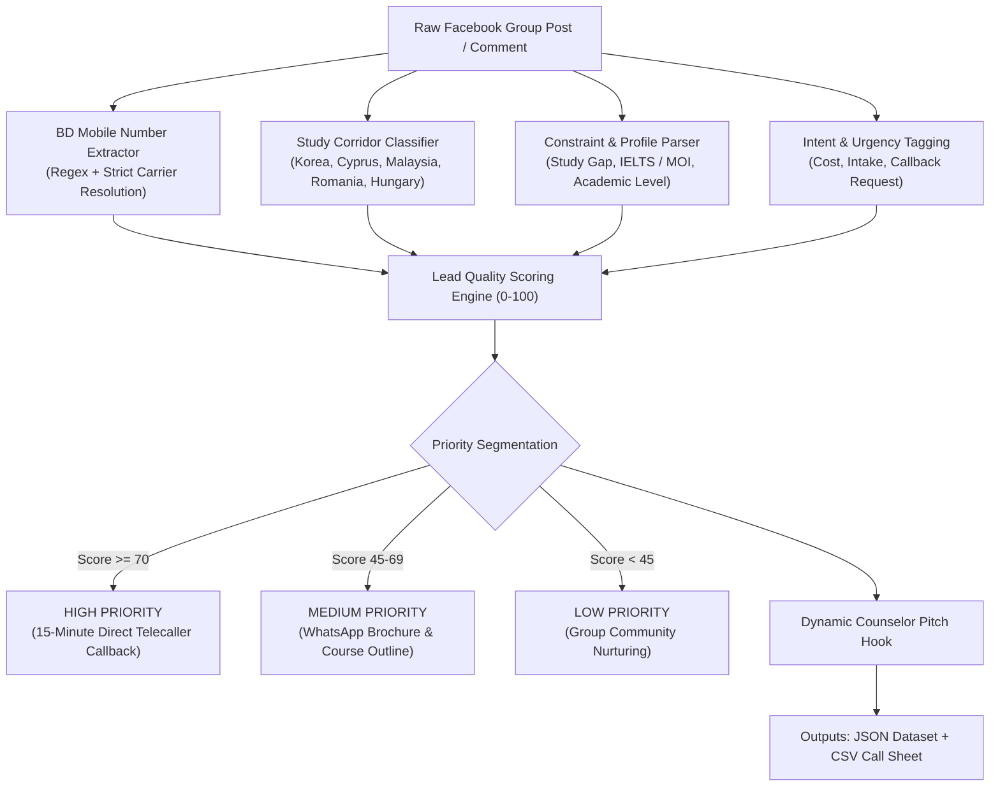

# 🎯 Keystone Overseas — Student Lead Group Harvester

> **Purpose:** Automated harvesting, qualification, and lead scoring engine targeting prospective Bangladeshi students in public study abroad Facebook groups, education forums, and social communities.

---

## ⚡ Quick Start

### 1. Run Benchmark / Verification Mode (Instant Test)
Uses authentic Bangladeshi study abroad Facebook group inquiries to demonstrate parsing, phone extraction, scoring, and CSV generation:

```bash
# Node.js (immediate execution on Windows/Linux)
node scrapers/student_group_lead_harvester.js --mode benchmark

# Or Python
python scrapers/student_group_lead_harvester.py
```

### 2. Parse Saved Facebook Group Discussions (HTML Feed)
Save any public Facebook group discussion page using your browser (`Ctrl + S` -> `Webpage, Complete` or `HTML Only`), then feed it directly into the parser:

```bash
node scrapers/student_group_lead_harvester.js --mode file --file "C:/path/to/group_feed.html"
```

---

## 📊 Pipeline Capabilities



---

## 📱 Bangladeshi Phone Normalization & Carrier Mapping

The regex handles spaces, hyphens, and standard BD country code variants (`+880`, `880`, or local `01...`):

| Prefix | Mobile Operator | Auto WhatsApp Link Generated |
| :---: | :---: | :---: |
| `013`, `017` | **Grameenphone (GP)** | `https://wa.me/88017...` |
| `014`, `019` | **Banglalink (BL)** | `https://wa.me/88019...` |
| `018` | **Robi** | `https://wa.me/88018...` |
| `016` | **Airtel** | `https://wa.me/88016...` |
| `015` | **Teletalk** | `https://wa.me/88015...` |

---

## 🎓 Targeted Corridors & Pitch Hooks

The harvester automatically maps each student inquiry to Keystone Overseas' specific corridor advantages:

1. **South Korea Flagship**:
   - *Target universities*: IEQAS certified (Kyungsung, Sejong, Dong-A, Kyungdong, etc.).
   - *Hook*: Direct D-2/D-4 visa processing, high visa approval rate, campus part-time work rights.
2. **Republic of Cyprus (South Cyprus)**:
   - *Advantage*: Direct university CRMD Entry Permit (Blue Paper).
   - *Hook*: **Zero embassy trip to India/Delhi**, up to 8+ years study gap accepted, no mandatory IELTS.
3. **Malaysia Corridor**:
   - *Advantage*: EMGS fast eVAL issuance within 21 days.
   - *Hook*: Affordable tuition, low cost of living, high Asian education ranking.
4. **Romania & Hungary (Europe Schengen)**:
   - *Advantage*: Romanian language preparatory year & technical polytechnic diplomas; Hungary direct VFS Dhaka processing with MOI acceptance.

---

## 📁 Output Artifacts

- **`scrapers/student_leads.json`**: Complete structured JSON array containing candidate metadata, raw text, intent signals, and scores.
- **`scrapers/student_leads_call_sheet.csv`**: Formatted spreadsheet ready for telecallers, sorted descending by `Lead Score` with one-click `WhatsApp Link` column.
